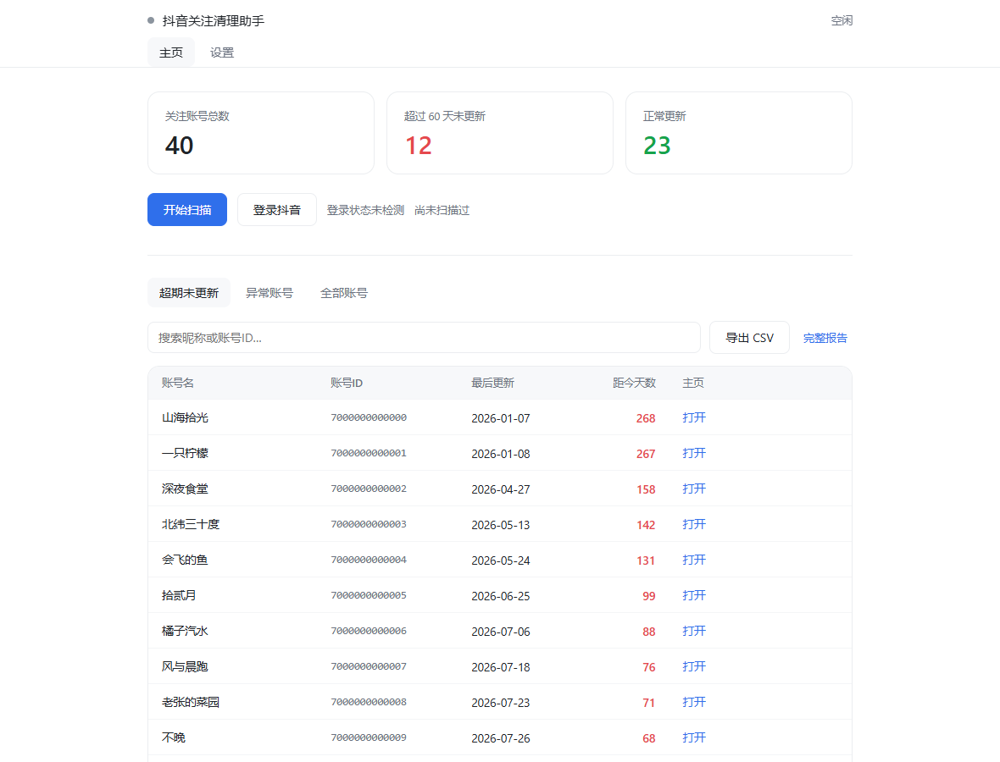
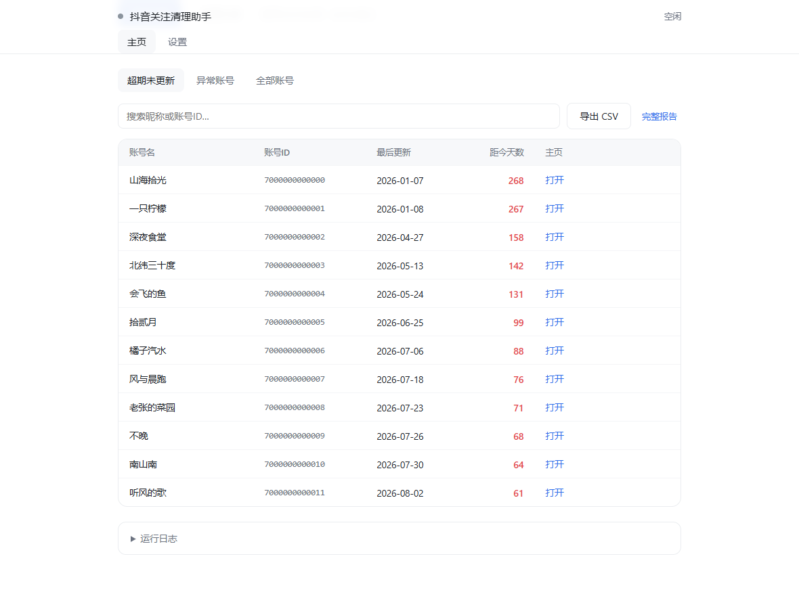
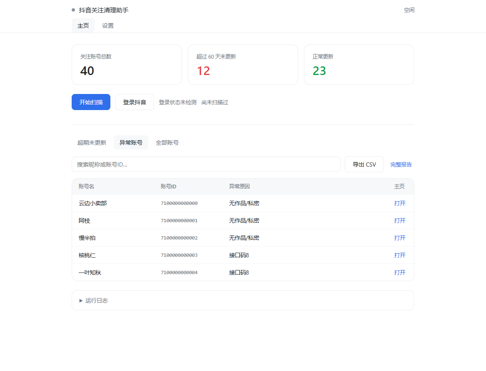
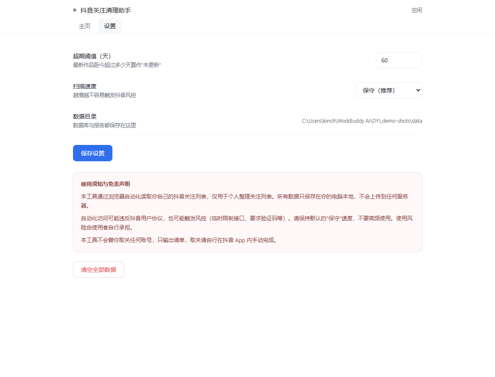
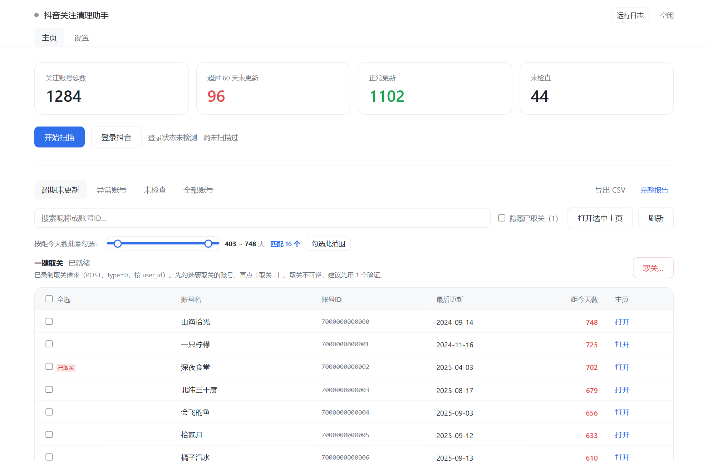
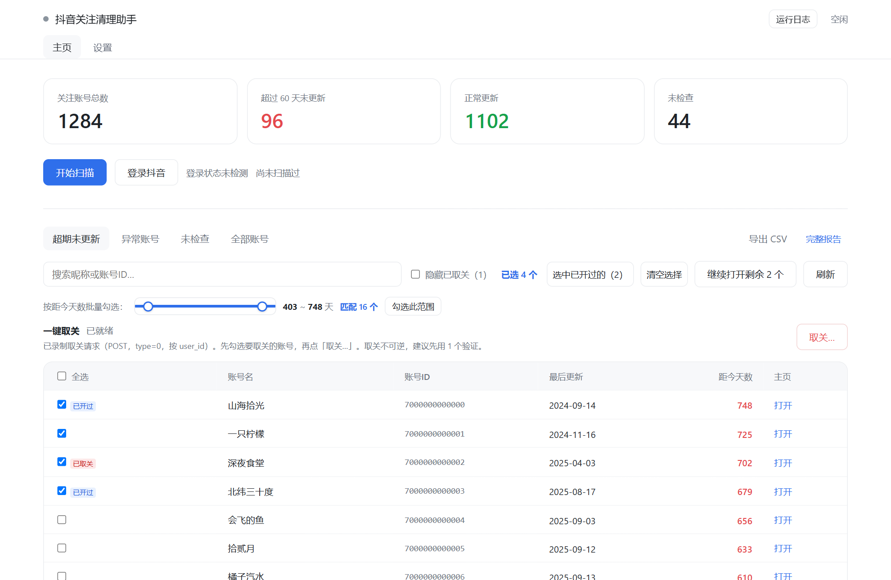
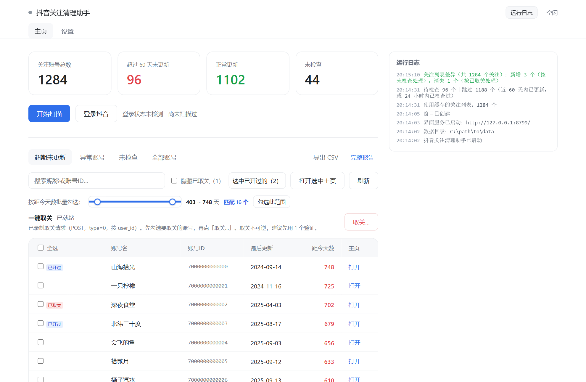

# 抖音关注清理助手

**douyin-follow-cleaner** — 一键扫描你的抖音关注列表，找出其中**超过 N 天（默认 60 天）没有更新**的账号，导出清单，并可选地**批量取关**。

Rust + 系统 WebView2 原生桌面应用 · 约 1 MB · 免安装 · 数据不出本机。  

## 为什么有这个项目

抖音 App 自带的「关注」批量管理，只能筛选**超过 180 天未更新**的账号，而且列表**不能完整显示**（会出现遗漏）。

对于关注数已经达到 1 万、无法再关注新账号的用户来说，清理长期未更新的账号是腾出关注名额的有效途径。  
所以有了这个项目：把筛选阈值降到默认 60 天，完整拉取全部关注列表并逐个检查，支持导出清单，也支持在验证后批量取关。  



---

## ⚠️ 免责声明（请先阅读）

- 本项目仅供**个人学习与自用**，用于整理自己的关注列表。
- 自动化访问抖音**可能违反其用户协议**，也可能触发风控（临时限制接口、要求验证码等）。**使用风险由使用者自行承担。**
- 请**不要**高频、大规模、商业化使用，也不要用于抓取他人数据。
- **「一键取关」会用你自己录制的请求批量取消关注，属于不可逆操作。** 请务必先用 1 个账号验证效果再考虑批量；建议每轮 20~50 个、分多天进行。取关频率过高可能触发风控，风险由使用者自行承担。
- 所有数据（登录态、数据库、报告）只保存在你的电脑本地，**不会上传到任何服务器**。

如果你不能接受以上风险，请不要使用本项目。

---

## 功能

| 功能 | 说明 |
|---|---|
| 🔍 一键扫描 | 自动拉取全部关注账号，逐个判断最后更新时间 |
| ♻️ 增量扫描 | 只检查「超期未更新」和「新关注」的账号，不重复劳动 |
| ⏯️ 断点续传 | 停止后再开始是**接着走**：24 小时内已检查过的账号自动跳过，不从头重来 |
| ✅ 勾选与批量选择 | 逐行勾选 / 表头全选 / 按「距今天数」滑杆区间批量勾选 / 一键选中已开过的 |
| 🚪 批量打开主页 | 用默认浏览器逐个打开选中账号的主页，每个间隔 ≥1 秒，每 20 个暂停等你确认 |
| 🗑️ 一键取关 | 录制一次真实取关请求后即可批量取关；命中风控立即熔断，中断后可接着做 |
| 🏷️ 进度标记 | 「已开过」（本次会话）/「已取关」（持久化）标注在勾选框旁，可一键隐藏已取关 |
| 🔄 列表差异对比 | 距上次超过 24 小时会完整重读关注列表并与关注数校验，新增按未检查、消失按已取关处理 |
| 😴 预防性休息 | 每处理 N 个账号主动暂停，尽量不触发风控 |
| 📄 导出报告 | 导出 CSV 表格 + 一键查看可视化 HTML 报告 |
| 🔒 全程本地 | 复用系统已装的 Edge 内核，后台无窗口运行，不下载额外浏览器 |

---

## 界面预览

界面只有两个页面：**主页**（概览 + 扫描进度 + 结果清单，合一页）和**设置**。

| 主页 · 结果清单 | 异常账号 |
|---|---|
|  |  |

| 设置页 |
|---|
|  |

**取关相关：**

| 取关入口与选中状态 | 勾选 + 已开过 / 已取关标记 |
|---|---|
|  |  |

| 按距今天数滑杆批量勾选 · 运行日志栏（可折叠） |
|---|
|  |

---

## 环境要求

- **Windows 10 / 11**
- **Microsoft Edge WebView2 运行时** —— Win11 与较新的 Win10 已内置；老系统可从[微软官网](https://developer.microsoft.com/microsoft-edge/webview2/)免费安装
- 运行时**不需要**装 Rust / Node / Python 等任何东西

---

## 快速开始

### 方式一：直接下载（最省事）

到 [Releases](../../releases) 下载 `douyin-follow-cleaner-v1.0.0-win64.zip`，解压后得到三个文件：

```
douyin-follow-cleaner.exe
WebView2Loader.dll
config.example.json
```

双击 `douyin-follow-cleaner.exe` 即可，无需安装。

> **`WebView2Loader.dll` 必须与 exe 放在同一目录**，否则会提示缺少 DLL。
> 想改默认配置的话，把 `config.example.json` 复制一份改名为 `config.json`，放同目录。

### 方式二：自己编译

```bat
build.bat
```

脚本会自动检查工具链、编译、并把 `WebView2Loader.dll` 复制到产物旁边。首次编译约 10 分钟。

产物在 `target\release\`：

| 文件 | 大小 |
|---|---|
| `douyin-follow-cleaner.exe` | 约 1.0 MB |
| `WebView2Loader.dll` | 160 KB |

<details>
<summary>手动编译 / 环境准备</summary>

需要 **Rust（GNU 目标）**，无需 Visual Studio：

```bash
rustup toolchain install stable-x86_64-pc-windows-gnu
```

GNU 目标编译 `windows` crate 需要 **binutils**（提供 `dlltool` / `as`）。从 [MSYS2 仓库](https://repo.msys2.org/mingw/mingw64/) 下载 `mingw-w64-x86_64-binutils-*.zst`，解压后把 `mingw64\bin` 里的内容放到 `%USERPROFILE%\.rustup\binutils`。

然后：

```bash
cargo build --release
```

</details>

### 首次使用

1. 双击 `douyin-follow-cleaner.exe`
2. 点界面右上角**「登录抖音」**，用抖音 App 扫码
3. 回到主页点**「开始扫描」**
4. 扫描完成后切到「超期未更新」，就是你要的清单

> 登录态会保存在 exe 同级的 `data/profile/`，之后不用重复扫码。

---

## 扫描速度

在「设置」页可以切换速度档，**默认「标准」**：

| 档位 | 小批次暂停 | 预防性休息 | 请求间隔 | 风险 |
|---|---|---|---|---|
| 保守 | 每 25~50 个停 3~8 秒 | 每 500~650 个停 60~90 分钟 | 300~800ms | 最低 |
| **标准（默认）** | 每 50~100 个停 1~3 秒 | 每 1500~2000 个停 20~30 分钟 | 120~300ms | 中 |
| 快速 | 每 100~200 个停 0~1 秒 | 不休息 | 50~150ms | **高** |

> 实测抖音大约每 1000~1500 次请求会触发一次接口级风控。命中后程序会重试 **3 次、每次等 30 分钟**，仍失败才停止本轮（进度已保存，可稍后继续）。
> 全量扫描 9000+ 账号预计需要数小时，可以挂着过夜跑。

---

## 输出文件

所有文件保存在数据目录（exe 同级的 `data/`）：

| 文件 | 内容 |
|---|---|
| `douyin_accounts.db` | SQLite 数据库，主数据源 |
| `report.html` | 可视化报告（界面「完整报告」可打开） |
| `stale_accounts.csv` | 超期未更新账号：账号名 / 账号ID / 账号URL / 最后更新日期 / 距今天数 / 作品数 |
| `error_accounts.csv` | 异常账号（无作品、私密、接口异常等） |
| `all_accounts.csv` | 全部账号 |
| `following_all.json` / `following_meta.json` | 关注列表缓存与断点续传元数据 |
| `profile/` | 浏览器登录态（**含隐私，切勿外传**） |
| `unfollow_template.json` | 录制的取关请求（**含会话指纹参数，切勿外传**） |

数据库表结构：

```sql
CREATE TABLE accounts (
  sec_uid TEXT PRIMARY KEY,   -- 抖音安全 ID
  uid TEXT,                   -- 数字 ID
  nickname TEXT,              -- 账号名
  home_url TEXT,              -- 主页 URL
  avatar TEXT,
  aweme_count INTEGER,        -- 作品数
  last_update_ts INTEGER,     -- 最后更新时间戳
  last_update_date TEXT,      -- 最后更新日期 YYYY-MM-DD
  status TEXT,                -- active | stale | error
  note TEXT,                  -- 异常原因
  first_seen_at INTEGER,      -- 首次见到（用于识别"新关注"）
  last_checked_at INTEGER,    -- 上次检查时间（用于「停止后继续」跳过已检查的）
  unfollowed_at INTEGER       -- 已取关时间（NULL 表示未取关）
);
```

用 SQL 直接查：

```bash
sqlite3 data/douyin_accounts.db \
  "SELECT nickname, uid, last_update_date,
          (strftime('%s','now')-last_update_ts)/86400 AS days
   FROM accounts
   WHERE last_update_ts IS NOT NULL
     AND (strftime('%s','now')-last_update_ts)/86400 > 60
   ORDER BY days DESC;"
```

---

## 命令行参数

```bash
douyin-follow-cleaner.exe --port=8799     # 指定界面端口（被占用时会自动往后找）
douyin-follow-cleaner.exe --out=D:\data   # 指定数据目录
```

---

## 配置

复制 `config.example.json` 为 `config.json`，放在 exe 同级目录即可覆盖默认值。所有字段都有默认值，可以只写需要改的部分。

常用项：

| 字段 | 默认 | 说明 |
|---|---|---|
| `staleDays` | 60 | 最新作品距今超过多少天算「未更新」 |
| `speed` | `standard` | 速度档位：`conservative` / `standard` / `fast` |
| `recheckHours` | 24 | 已检查过的账号在多少小时内不重复检查（用于「停止后继续」） |
| `retry.retryWaitSec` | 1800 | 账号检查命中风控后每次重试的等待秒数 |

---

## 工作原理

1. **登录**：用系统 Edge 内核打开抖音，你扫码后把登录态存到本地 `profile/`。
2. **拉关注列表**：复用页面自身发出的请求参数（含签名），翻页取全部关注账号。
3. **逐个检查**：对每个账号请求其主页接口，取最新作品时间，判断是否超过阈值。
4. **入库 + 出报告**：结果写入 SQLite，同时生成 CSV 与 HTML 报告。

### 几个实测经验（已内置在代码里）

- 网页接口**不需要** `a_bogus` / `X-Bogus` 签名；**带上反而会被拦截**。所以请求时不带签名参数。
- 列表接口的限流恢复期很长，2 分钟远远不够，默认等 **30 分钟**。
- 风控是按请求数累积的，大约每 1000~1500 次触发一次，所以「主动休息」比「被拦后等待」划算。
- **完全不用浏览器不可行**：登录需扫码，且作品接口强制校验签名（纯 HTTP 客户端无法生成）。

---

## 常见问题

**Q: 卡在"等待中"不动？**
说明触发了风控。程序会按重试上限重试，超过就停止本轮。**稍等约 1 小时再运行即可，数据不会丢。**

**Q: 提示"尚未登录"？**
回到首页点「登录抖音」，扫码即可。

**Q: 有些账号显示"无作品/私密"？**
该账号没有公开作品、是私密账号或已注销，会归入「异常账号」。

**Q: 扫描点「停止」后，再点「开始扫描」会从头来吗？**
不会。24 小时内已检查过的账号会被跳过，直接接着上次的进度走。

**Q: 「一键取关」安全吗？会不会取关错人？**
取关用的是**你自己录制的那次真实请求**，只把目标账号 ID 换掉，其余参数原样重放。请务必**先用 1 个账号验证**再批量。命中风控会立即熔断停止。抖音改版或长时间未用后录制可能失效，到「设置」页重新录制即可。

**Q: 取关到一半停了，要重新勾选吗？**
不用。停止后按钮会变成「继续取关剩余 N 个」，点它只做没做完的那部分，不会重复取关已完成的。

**Q: 双击没反应 / 提示缺少 DLL？**
`WebView2Loader.dll` 必须和 exe 放在同一目录。若仍不行，安装 [WebView2 运行时](https://developer.microsoft.com/microsoft-edge/webview2/)。

**Q: 界面能换语言吗？**
目前仅中文。欢迎提交 PR 增加多语言。

---

## 项目结构

```
douyin-follow-cleaner/
├── Cargo.toml
├── build.bat            一键构建（编译 + 复制 DLL）
├── assets/
│   └── app.html         整个界面（编译进二进制）
├── src/
│   ├── main.rs          入口：建窗口、加载界面
│   ├── server.rs        本地 HTTP 服务（界面资源 + /api/*）
│   ├── state.rs         全局状态、进度、日志、通知
│   ├── config.rs        配置与速度档位
│   ├── db.rs            SQLite 数据层（调用系统 winsqlite3.dll）
│   ├── scanner.rs       扫描引擎（增量 / 续传 / 限速 / 暂停停止）
│   ├── douyin.rs        抖音接口封装（登录、列表、主页、取关）
│   ├── cdp.rs           极简 CDP 客户端（零依赖，直接驱动系统 Edge）
│   └── report.rs        CSV / HTML 报告生成
├── docs/                截图与文档
└── config.example.json
```

---

## 架构说明

| 环节 | 做法 | 省掉了什么 |
|---|---|---|
| 界面渲染 | 用**系统自带的 WebView2**（Win10/11 内置 Edge 内核） | 不捆绑 Chromium（-150MB） |
| 后端运行时 | 用 **Rust** 编译成原生机器码 | 不捆绑 Node / Python 运行时（-80MB） |
| 数据库 | 调用系统自带的 `winsqlite3.dll` | 不捆绑 SQLite 源码 |
| 浏览器自动化 | 自己实现**原生 CDP 客户端** | 不需要 Playwright / Puppeteer |
| 界面与后端通信 | 本地 HTTP（127.0.0.1，随机端口 + 令牌鉴权） | 不需要额外 IPC 抽象层 |

> 通信走本地 HTTP 而不是 WebView2 原生 IPC，是为了让界面 HTML 能被浏览器直接打开调试，
> 接口也能用 `curl` 直接测。只绑 `127.0.0.1`，端口被占用会自动往后找，
> 所有 `/api/*` 请求需要启动时生成的随机令牌（注入页面，跨站页面读不到）。

---

## 排障

### 窗口打开后一片空白

1. 看 exe 同级的 `data/app.log`，是否有 `[HTTP] GET /` 记录：
   - **有** → 页面已加载，问题在前端，按 F12 看控制台
   - **没有** → WebView2 或端口问题，检查是否装了运行时
2. 如果日志里写「端口 xxx 被占用，已自动改用 yyy」是正常的，程序会自己换端口。

### 想调试前端

设环境变量 `DYC_DEBUG_PORT` 打开 DevTools 调试端口：

```bat
set DYC_DEBUG_PORT=9333
douyin-follow-cleaner.exe
```

然后用 Playwright 等工具连接 `http://127.0.0.1:9333`。

---

## License

[MIT](LICENSE)
